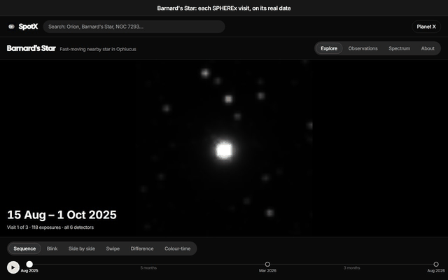

# SpotX | https://spherexspotx.netlify.app/

[](https://github.com/packtryer-design/SphereX/actions/workflows/ci.yml)
[](pyproject.toml)
[](LICENSE)

**Search a nebula and watch how it looks across every visit NASA's SPHEREx telescope has made to it.**



*Real SPHEREx data: Barnard's Star moving between visits. Full 40-second demo with captions: [docs/media/spotx-demo.mp4](docs/media/spotx-demo.mp4).*


In 1930 Clyde Tombaugh found Pluto by "blinking" between two photos of the same sky taken days apart. SpotX does the same with SPHEREx, the infrared telescope that maps the whole sky in 102 colours about every six months. Pick an object, then step through its real observation dates. SpotX between two visits, put them side by side, swipe between them, or subtract one from the other to see what changed. Spectra are there as an extra layer: click a spot to see how bright it is in each infrared colour.

Built for the NASA Space Apps Challenge 2026 (Sharjah), SPHEREx challenge. Team plan: [docs/PLAN.md](docs/PLAN.md).

## Run it

```bash
uv venv --python 3.12 .venv
uv pip install --python .venv numpy astropy astroquery reproject pillow fastapi uvicorn httpx
.venv/Scripts/python -m uvicorn api.main:app --port 8000      # macOS/Linux: .venv/bin/python
```

Open http://localhost:8000. With an activated environment, `make serve` does the same.

The first time you open an object, SpotX downloads its exposures from IRSA and builds the images, which takes a few minutes. After that the object loads instantly. `make warm` pre-builds every catalog object.

## Public site (Netlify)

The site is deployed on Netlify as static files (`netlify.toml`: publish `web/`, no build step). Netlify can't run the Python API, so the site ships with a **snapshot**: the results for the demo objects (visit lists, images for every view, spectra, and the Planet X page), pre-built and saved as plain files in `web/snapshot/`. With no live API around, the site reads those instead and lists only the objects they cover.

To add or refresh objects in the snapshot:

```bash
python scripts/warm_cache.py ring helix       # build them locally (downloads from NASA)
python scripts/build_snapshot.py ring helix   # export them, plus the default demo objects
```

Then commit `web/snapshot/` and push: Netlify redeploys on its own.

## How we know it works

Our code on real SPHEREx frames, checked against independent measurements. Rebuild with
`python scripts/build_results.py` (writes `web/data/results.json`, shown on the home page).

| Check | SPHEREx (ours) | Independent answer |
|---|---|---|
| Barnard's Star proper motion | 10.0 ± 1.8 ″/yr | 10.4 (Gaia DR3) |
| Epsilon Indi B proper motion | 4.68 ± 0.06 ″/yr | 4.68 (published) |
| WISE 0855 proper motion | 9.2 ± 1.1 ″/yr | 8.2 (published) |
| RW Aur, R Dra (should not move) | 0.8 ± 1.6, 0.6 ± 0.8 ″/yr | ~0 |
| Pluto, blind shift-and-stack find | 1.9″ from predicted spot | NASA JPL Horizons |
| Faintest planted planet recovered | 45× fainter than Pluto (46 frames, 3 days) | — |
| 4.2-5.0 µm flux vs WISE W2 | WISE 0855 −14%, Eps Indi B −15% | AllWISE |

What the planet limit means: one 3-day SPHEREx visit could catch a Neptune-size planet out to
about 280-420 AU (5× darker than Pluto, or as reflective), unless it sits behind a bright star.
Molecule labels are only shown as "seen" when the dip is measured: Eps Indi B shows its water,
methane and CO bands; for WISE 0855 only the bright 4-4.4 µm window is clear, the short-wave
bands are too faint and are labelled so.

## How it fits together

```
web/  (static HTML/JS)                       api/  (FastAPI)
 search ─ catalog: web/data/objects.json      /api/visits     real visit dates (IRSA query only)
        └ any name ─────────────────────────► /api/resolve    SIMBAD, then NED
 Explore / Observations ────────────────────► /api/frames     cutouts → common grid → stack per visit
                                                              → PNG (epoch | diff | rgb | single)
 Spectrum ──────────────────────────────────► /api/surface-spectrum   nebulae, same cutouts
                                              /api/spectrum   stars (aperture photometry)
                                              /api/ghosts, /api/asteroids   Gaia + SkyBoT
```

- [web/README.md](web/README.md): the front end, its views, and the API it uses.
- [docs/BACKEND_IMAGING.md](docs/BACKEND_IMAGING.md) and [docs/HANDOFF_IMAGING.md](docs/HANDOFF_IMAGING.md): the imaging pipeline.

## Data and credits

- Images: NASA/JPL-Caltech/IPAC **SPHEREx**, through the [NASA/IPAC Infrared Science Archive](https://irsa.ipac.caltech.edu/Missions/spherex.html).
- Object positions and types: [SIMBAD](https://simbad.cds.unistra.fr/) (CDS), with [NED](https://ned.ipac.caltech.edu/) as a fallback for name lookup.
- Design: colours, type and component styles ported from [Shadcn UI Kit](https://github.com/bundui/shadcn-ui-kit) (MIT) into plain CSS. Fonts: Inter and Cal Sans via Google Fonts.

## Development

| Command | What it does |
|---|---|
| `make serve` | API + front end on port 8000 |
| `make objects` | Rebuild the catalog from SIMBAD + IRSA |
| `make warm` | Pre-build images for every catalog object, plus spectra for the science targets |
| `python scripts/record_demo.py` | Re-record the demo video and GIF from the running app (dev setup in the script) |
| `make test` | Tests |
| `make lint` | Ruff lint and format check |
| `make typecheck` | Mypy |

## License

[MIT](LICENSE)
