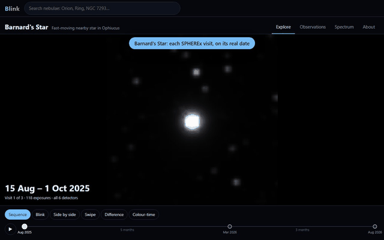

# Blink

[](https://github.com/packtryer-design/SphereX/actions/workflows/ci.yml)
[](pyproject.toml)
[](LICENSE)

**Search a nebula and watch how it looks across every visit NASA's SPHEREx telescope has made to it.**



*Real SPHEREx data: Barnard's Star moving between visits. Full 40-second demo with captions: [docs/media/blink-demo.mp4](docs/media/blink-demo.mp4).*


In 1930 Clyde Tombaugh found Pluto by "blinking" between two photos of the same sky taken days apart. Blink does the same with SPHEREx, the infrared telescope that maps the whole sky in 102 colours about every six months. Pick an object, then step through its real observation dates. Blink between two visits, put them side by side, swipe between them, or subtract one from the other to see what changed. Spectra are there as an extra layer: click a spot to see how bright it is in each infrared colour.

Built for the NASA Space Apps Challenge 2026 (Sharjah), SPHEREx challenge. Team plan: [docs/PLAN.md](docs/PLAN.md).

## Run it

```bash
uv venv --python 3.12 .venv
uv pip install --python .venv numpy astropy astroquery reproject pillow fastapi uvicorn httpx
.venv/Scripts/python -m uvicorn api.main:app --port 8000      # macOS/Linux: .venv/bin/python
```

Open http://localhost:8000. With an activated environment, `make serve` does the same.

The first time you open an object, Blink downloads its exposures from IRSA and builds the images, which takes a few minutes. After that the object loads instantly. `make warm` pre-builds every catalog object.

## How it fits together

```
web/  (static HTML/JS)                       api/  (FastAPI)
 search ─ catalog: web/data/objects.json      /api/visits     real visit dates (IRSA query only)
        └ any name ─────────────────────────► /api/resolve    SIMBAD, then NED
 Explore / Observations ────────────────────► /api/frames     cutouts → common grid → stack per visit
                                                              → PNG (epoch | diff | rgb | single)
 Spectrum ──────────────────────────────────► /api/surface-spectrum   nebulae, same cutouts
                                              /api/spectrum   stars (aperture photometry)
                                              /api/ghosts, /api/asteroids   Gaia + SkyBoT
```

- [web/README.md](web/README.md): the front end, its views, and the API it uses.
- [docs/BACKEND_IMAGING.md](docs/BACKEND_IMAGING.md) and [docs/HANDOFF_IMAGING.md](docs/HANDOFF_IMAGING.md): the imaging pipeline.

## Data and credits

- Images: NASA/JPL-Caltech/IPAC **SPHEREx**, through the [NASA/IPAC Infrared Science Archive](https://irsa.ipac.caltech.edu/Missions/spherex.html).
- Object positions and types: [SIMBAD](https://simbad.cds.unistra.fr/) (CDS), with [NED](https://ned.ipac.caltech.edu/) as a fallback for name lookup.

## Development

| Command | What it does |
|---|---|
| `make serve` | API + front end on port 8000 |
| `make objects` | Rebuild the catalog from SIMBAD + IRSA |
| `make warm` | Pre-build images for every catalog object, plus spectra for the science targets |
| `python scripts/record_demo.py` | Re-record the demo video and GIF from the running app (dev setup in the script) |
| `make test` | Tests |
| `make lint` | Ruff lint and format check |
| `make typecheck` | Mypy |

## License

[MIT](LICENSE)
